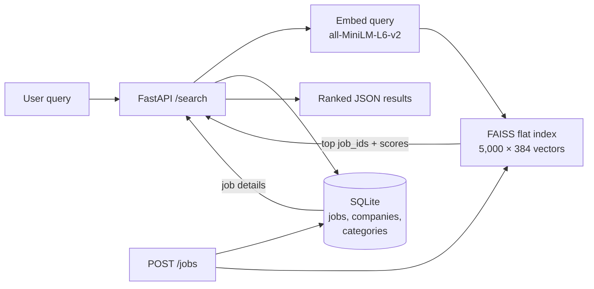

# JobSense: Semantic Job Search

Search 5,000 real job postings by meaning, not keywords. Ask for *"protecting company computers from hackers"* and get cybersecurity jobs, even though no posting says "hackers".

**Live demo:** https://jobsense-8r6g.onrender.com (opens the interactive API docs)
> Hosted on Render's free tier: after 15 minutes without traffic the service sleeps, so the first request can take a while (cold start: _not measured yet_). Later requests are fast.

**Stack:** Python · FastAPI · sentence-transformers (all-MiniLM-L6-v2) · FAISS · SQLite · Docker · Render

---

## Results

Evaluated on 20 test queries (10 title-style like *"tax manager"*, 10 natural-language like *"fixing heating and air conditioning"*) with 201 relevance labels.

| System | P@5 | P@5 title-style | P@5 natural-language | MRR@5 | Median ranking latency* |
|---|---|---|---|---|---|
| BM25 (keyword baseline) | 0.68 | 0.86 | 0.50 | 0.81 | ~4–8 ms |
| **Embeddings + FAISS (deployed)** | **0.80** | **0.92** | **0.68** | **0.90** | **~14 ms** |
| Embeddings + cross-encoder re-rank | 0.81 | 0.88 | 0.74 | 0.90 | ~3,500 ms |

\*Per query on a 2-core GitHub Codespace (median of 100 runs per system; small timings vary between runs).

- **Semantic search beats keyword search most on natural-language queries** (0.68 vs 0.50). Example: for *"protecting company computers from hackers"*, BM25 scored 0.0 and embeddings 1.0.
- **Not statistically significant at this size.** Per query, embeddings won 7, lost 4 and tied 9 against BM25 (sign test p = 0.55). Many more queries would be needed to prove a difference.
- **The re-ranker was not shipped.** It added 0.01 P@5 (won 6, lost 5; p = 1.00) at ~250× the latency. Its new errors rewarded topic overlap, such as an HVAC *sales* job for an HVAC *repair* query.

**Live performance** (Render free tier, 512 MB RAM / 0.15 CPU): median 14.7 ms server-side search, 0.85 s end-to-end from a GitHub Codespace (5 requests). Network time dominates.

### How the evaluation works
- **Pooling:** for each query, the top-5 results from every system were merged into one pool and labeled. This gives exact precision@5 for each system without labeling all 5,000 jobs.
- **Blind labels:** an LLM judge (Claude) labeled each (query, job) pair against a relevance rule written beforehand, without knowing which system returned it. Every borderline decision is logged in [`evaluation/labeling_decisions.md`](evaluation/labeling_decisions.md).
- **Human check:** a random sample was hand-labeled without seeing the judge's answers: 29/30 agreement (Cohen's κ = 0.93), and 14/15 (κ = 0.76) for the second round of labels.
- **Limits:** 20 queries, a single judge plus one human checker, and pooling measures precision, not recall.

---

## Architecture



- **FAISS** answers "which jobs are closest in meaning?" and returns job IDs. **SQLite** stores everything about each job. The `job_id` links the two.
- **SQLite is the source of truth.** At startup the API reconciles FAISS with the database, embedding any missing jobs and removing deleted ones, so the two can't drift apart permanently.
- **Adding a job doesn't rebuild the index:** embed one job, insert it in one transaction, add one vector. That took under 1 s (80–576 ms over 3 runs), versus 426 s to re-embed everything.

### Key design decisions
| Decision | Why |
|---|---|
| Embed title + first 1,000 characters | The model reads at most 256 tokens; 89.7% of postings are longer (median 651 tokens) |
| Normalized vectors + inner-product index | Inner product of unit vectors = cosine similarity |
| Exact (flat) FAISS index | ~1 ms at 5,000 vectors with perfect recall; HNSW/IVF only pay off at much larger scale |
| Normalized schema with a link table | A job averages ~1.65 categories (many-to-many) |
| `AUTOINCREMENT` job IDs | Found in testing: SQLite reused a deleted job's ID |
| Writes need an `X-API-Key` header | Strangers can't add or delete jobs on the public demo |
| Model and index baked into the Docker image | Fast, reliable cold starts with no dependency on Hugging Face at runtime |

---

## Data

[LinkedIn Job Postings (2023–2024)](https://www.kaggle.com/datasets/arshkon/linkedin-job-postings) by Arsh Koneru and Zoey Yu Zou on Kaggle. See the Kaggle page for the dataset's license.

| Step | Rows |
|---|---|
| Raw postings | 123,849 |
| Removed: empty title/description | 7 |
| Removed: description under 200 characters | 636 |
| Removed: duplicates | 12,821 (~10%) |
| After cleaning | 110,385 |
| Random sample indexed (seed 42) | **5,000** |

Database: 5,000 jobs, 3,037 companies, 35 categories, 8,228 job-category links, 0 foreign-key violations.

---

## API

| Endpoint | What it does |
|---|---|
| `GET /search?query=...&top_k=5&category=IT` | Semantic search, optional category filter |
| `GET /jobs/{job_id}` | Full details of one job |
| `GET /categories` | Category codes and job counts |
| `GET /health` | Status and number of indexed jobs |
| `POST /jobs` | Add a job, searchable immediately (needs `X-API-Key`) |
| `DELETE /jobs/{job_id}` | Remove a job (needs `X-API-Key`) |

```bash
curl "https://jobsense-8r6g.onrender.com/search?query=helping+patients+recover+from+injuries&top_k=3"
```

---

## Run it yourself

```bash
# 1. Install (CPU-only PyTorch first)
pip install torch --index-url https://download.pytorch.org/whl/cpu
pip install -r requirements.txt kaggle

# 2. Get the data (needs a Kaggle API token in KAGGLE_API_TOKEN)
kaggle datasets download arshkon/linkedin-job-postings -p data/raw --unzip

# 3. Build everything
python scripts/prepare_data.py --raw data/raw/postings.csv --out data/jobs_clean.csv --n 5000
python -m scripts.build_index      # embeddings + FAISS index
python -m scripts.load_db          # SQLite

# 4. Run the API, then open http://localhost:8000/docs
ADMIN_API_KEY=choose-a-key uvicorn app.main:app --reload

# 5. Reproduce the evaluation
python -m evaluation.evaluate
```

**With Docker:**
```bash
docker build -t jobsense .
docker run -p 8000:8000 -e ADMIN_API_KEY=choose-a-key jobsense
```

---

## Project structure

```
app/
  main.py           FastAPI app: endpoints, startup reconcile, API-key check
  embedding.py      model loading + text-to-vector (shared by every part)
  vector_index.py   FAISS wrapper: add, remove, search, save, load
  db.py             SQLite access: parameterized queries, inserts, deletes
  schema.sql        tables, keys, constraints, indexes
  reranker.py       cross-encoder experiment (not used by the API)
scripts/            data cleaning, index building, DB loading, manual search
evaluation/         queries, labels, BM25 baseline, metrics, spot checks, results
Dockerfile          production image
```

---

## Limitations and next steps

- **20 evaluation queries** isn't enough for statistical significance. Next: 50–100 queries.
- **Truncation:** the model sees only the start of most postings. Next: embed chunks and score each job by its best chunk.
- **Hybrid search:** BM25 and embeddings win on different queries, so combining their rankings may beat both.
- **The free tier's disk resets:** jobs added through the live API disappear on restart or sleep. Production would use Postgres and persistent storage for the index.
- **0.15 CPU** is fine for a demo but would throttle under sustained traffic. Not load-tested.
